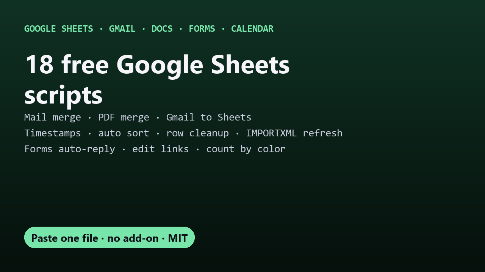


# Free Google Sheets scripts

Free, open-source Apps Script tools for Google Sheets, Gmail, Docs, Forms and Calendar. Each one is a **single file you paste into Extensions → Apps Script**: no add-on to install, no subscription, and your data stays in your Google account. All MIT licensed.

| Script | What it does | Guide |
|---|---|---|
| [Sheets Mail Merge](https://github.com/DecodedXR/sheets-mail-merge) | A personalized Gmail to every row, using a Gmail draft as the template. Attachments, inline images, a different file per person, never sends twice. | [Mail merge for free](https://decodedxr.github.io/sheets-mail-merge/free-mail-merge-google-sheets.html) · [Per-person attachments](https://decodedxr.github.io/sheets-mail-merge/mail-merge-with-attachments-google-sheets.html) |
| [Sheets Doc Merge](https://github.com/DecodedXR/sheets-doc-merge) | One PDF per row from a Google Docs template (certificates, invoices, letters), optionally emailed. An open-source Autocrat alternative. | [PDFs and certificates](https://decodedxr.github.io/sheets-doc-merge/generate-pdfs-certificates-from-google-sheets.html) · [Invoices](https://decodedxr.github.io/sheets-doc-merge/create-invoices-from-google-sheets.html) |
| [Sheets Deadline Reminders](https://github.com/DecodedXR/sheets-deadline-reminders) | Emails people every morning about rows due soon. Done/Paid checkbox to stop. | [Automatic reminders](https://decodedxr.github.io/sheets-deadline-reminders/automatic-email-reminders-google-sheets.html) · [Expiration dates](https://decodedxr.github.io/sheets-deadline-reminders/expiration-date-reminders-google-sheets.html) |
| [Sheets to Calendar](https://github.com/DecodedXR/sheets-to-calendar) | Rows become Google Calendar events and update when you edit them. Hourly sync. | [Sheets to Calendar](https://decodedxr.github.io/sheets-to-calendar/google-sheets-to-google-calendar.html) |
| [Gmail CSV to Sheets](https://github.com/DecodedXR/gmail-csv-to-sheets) | Imports CSV attachments from matching emails into a sheet every hour. Append or replace. | [Import CSV from Gmail](https://decodedxr.github.io/gmail-csv-to-sheets/import-csv-from-gmail-to-google-sheets.html) |
| [Dependent Dropdowns](https://github.com/DecodedXR/dependent-dropdowns) | The second dropdown follows the first on every row, chains to 3+ levels, and clears choices that no longer fit. | [Dependent drop-down lists](https://decodedxr.github.io/dependent-dropdowns/dependent-drop-down-list-google-sheets.html) |
| [Drive Upload Form](https://github.com/DecodedXR/drive-upload-form) | A public page where anyone uploads files into your Drive folder, no Google account needed. Logged in a sheet, with size, type, password and rate-limit guardrails. | [Uploads without sign-in](https://decodedxr.github.io/drive-upload-form/upload-files-to-google-drive-without-sign-in.html) |
| [Count and Sum by Color](https://github.com/DecodedXR/count-by-color) | `COUNTBYCOLOR` and `SUMBYCOLOR` formulas: count or total cells by fill or text color, with a one-click refresh. | [Count cells by color](https://decodedxr.github.io/count-by-color/count-cells-by-color-google-sheets.html) |
| [Drive CSV to Sheets](https://github.com/DecodedXR/drive-csv-to-sheets) | Drop CSV or Excel files in a Drive folder and they're imported into your sheet every hour. Append or replace, never twice. | [Auto-import from Drive](https://decodedxr.github.io/drive-csv-to-sheets/import-csv-from-google-drive-to-sheets-automatically.html) |
| [Sheets Edit Tracker](https://github.com/DecodedXR/sheets-edit-tracker) | Automatic "created" or "last updated" timestamps when rows are edited, plus an Edit Log of who changed what. | [Automatic timestamps](https://decodedxr.github.io/sheets-edit-tracker/automatic-timestamp-google-sheets.html) |
| [Row Cleanup](https://github.com/DecodedXR/sheets-row-cleanup) | Move rows to another tab when Status = Done, delete blank or zero rows, archive old rows nightly. Simple rules. | [Move or delete rows](https://decodedxr.github.io/sheets-row-cleanup/move-or-delete-rows-google-sheets.html) |
| [Time Zone Convert](https://github.com/DecodedXR/sheets-timezone-convert) | `TZ_CONVERT` formula: convert date-times between any time zones, daylight saving handled, whole ranges at once. | [Convert time zones](https://decodedxr.github.io/sheets-timezone-convert/convert-time-zones-google-sheets.html) |
| [Form Auto-Reply](https://github.com/DecodedXR/form-auto-reply) | Your own personalized email to every Google Form respondent, written as a Gmail draft. | [Custom confirmation email](https://decodedxr.github.io/form-auto-reply/google-forms-custom-confirmation-email.html) |
| [Form Prefill Links](https://github.com/DecodedXR/form-prefill-links) | A pre-filled Google Form link for every row, matched by question title. | [Prefill a form from a sheet](https://decodedxr.github.io/form-prefill-links/prefill-google-form-from-spreadsheet.html) |

Hit a free-tier limit on an add-on? See [free alternatives to paid Google Sheets add-ons](free-alternatives-to-google-sheets-add-ons.html).

## How every script works

1. Open your sheet → **Extensions → Apps Script**.
2. Delete the placeholder code, paste in the script's `Code.gs`, and save.
3. Reload the sheet and use the new menu.

The first run shows "Google hasn't verified this app", because it's your own unpublished script: **Advanced → Go to (your project name) → Allow**. Nothing is sent to any outside server.

## They work together

- Build per-person links with **Form Prefill Links**, then send them with **Mail Merge** (`{{Prefilled Link}}`).
- Generate invoices with **Doc Merge**, then chase unpaid ones with **Deadline Reminders** (tick **Paid** to stop).
- Email earlier Google Form respondents with **Mail Merge** directly on the response sheet.

## Also by DecodedXR

- [Autopilot & Wargame](https://github.com/DecodedXR/claude-workflow-skills): Claude Code skills for long, unattended sessions.
- [Heads-up](https://github.com/DecodedXR/heads-up): desktop notifications for Claude Code on Windows, macOS, Linux and WSL.

Found a bug or want a feature? Open an issue on that script's repo.

